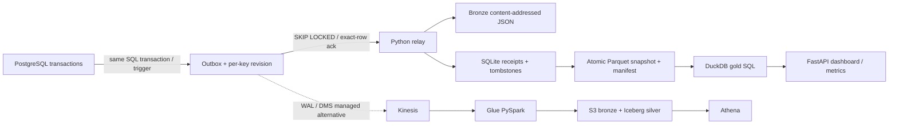
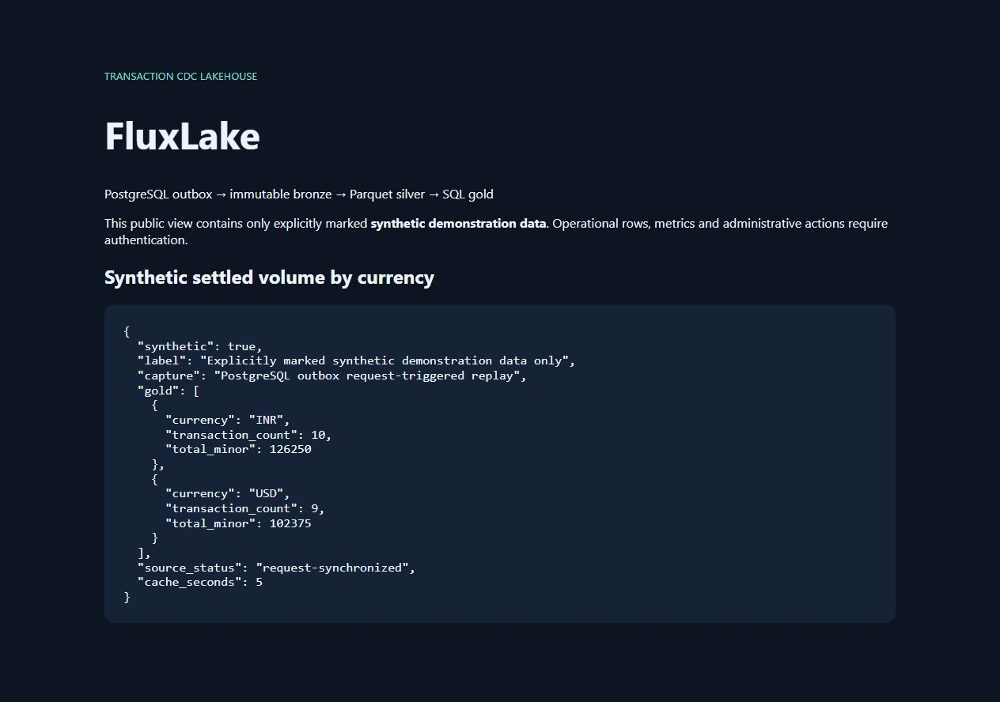

# FluxLake

[](https://github.com/9059Rohith/fluxlake/actions/workflows/verify.yml)

Hosted CI is currently blocked by an account-level runner restriction. [Executed local verification](evidence/verification.md) is recorded separately; no hosted pass is claimed.

**Verified public synthetic demo:** [Open FluxLake](https://rohith-fluxlake.vercel.app) · [Live summary API](https://rohith-fluxlake.vercel.app/demo/summary) · [Hosted deployment details](docs/public-deployment.md) · [Release evidence](evidence/public-release-verification.json).

The live service runs a Docker/OCI HTTP function on Vercel Hobby with durable PostgreSQL on Neon Free. It replays real retained outbox history on requests into disposable Parquet projections; it does not claim an always-on streaming worker. The verified source contains 22 real synthetic change events and produces 19 live rows across INR and USD.

A near-real-time transaction lakehouse you can run and break locally. PostgreSQL commits each transaction change and its outbox record atomically. A Python worker delivers those records at least once; the sink keeps one correctly ordered result, immutable bronze evidence, real Parquet silver snapshots, and currency-safe gold SQL aggregates.

**Local: transactional outbox polling, not WAL capture.** The optional AWS profile performs actual DMS WAL capture of the outbox into Kinesis and a Glue PySpark Iceberg `MERGE`. Managed infrastructure is supplied as deployable code; see [verification evidence](evidence/verification.md) for exactly what has run. The optional managed AWS stack remains unprovisioned; the verified public Vercel/Neon service uses the separate request-sync profile. No managed AWS capacity or production throughput is implied.



## Run locally

Requirements: Python 3.12–3.15 and Docker Engine / Docker Compose. Commands below use PowerShell; equivalent shell environment variables work on Linux.

```powershell
python -m venv .venv
.venv\Scripts\python -m pip install --no-deps -r requirements-dev.lock
.venv\Scripts\python -m pip install --no-deps -e .
$env:POSTGRES_PASSWORD = [guid]::NewGuid().ToString('N')
$env:FLUXLAKE_API_TOKEN = [guid]::NewGuid().ToString('N')
$env:FLUXLAKE_PUBLIC_DEMO = "true"
$env:FLUXLAKE_ALLOWED_HOSTS = "localhost,127.0.0.1"
# Persist these values in an ignored .env if you need to reuse the same DB volume.
docker compose up -d --build
$env:DATABASE_URL = "postgresql://fluxlake:$($env:POSTGRES_PASSWORD)@127.0.0.1:55433/fluxlake"
.venv\Scripts\python scripts/seed.py
Start-Process 'http://localhost:18082'
Invoke-RestMethod http://localhost:18082/demo/summary
```

Source writes go to PostgreSQL. `/events` is an authenticated fixture/replay route; use an isolated lake root when replaying arbitrary inputs. Operational reads, metrics, OpenAPI (`/openapi.json`) and writes require a strong bearer token. The optional public dashboard exposes only aggregates explicitly marked `synthetic=true`. Terminate TLS at public ingress; see [public hosting and request-sync configuration](docs/hosting.md).

Run the worker and API directly when Docker builds are unavailable:

```powershell
# PostgreSQL still runs in Compose; worker and API share the same --root.
docker compose up -d postgres
.venv\Scripts\fluxlake worker --root data
# In another terminal, with FLUXLAKE_API_TOKEN set:
.venv\Scripts\fluxlake api --root data --port 18082
```

To test with PostgreSQL:

```powershell
docker compose exec postgres createdb -U fluxlake fluxlake_test
$env:TEST_DATABASE_URL = "postgresql://fluxlake:$($env:POSTGRES_PASSWORD)@127.0.0.1:55433/fluxlake_test"
.venv\Scripts\python -m pytest -q
.venv\Scripts\ruff check .
.venv\Scripts\ruff format --check .
.venv\Scripts\pip-audit --disable-pip --no-deps -r requirements.lock
.venv\Scripts\python scripts/benchmark.py --events 200
```

Without `TEST_DATABASE_URL`, the database integration tests explicitly skip. [The reproducible benchmark](evidence/benchmark.json) reports measured durable sink latency and raw samples, with no simulated cloud claims. Batch size controls snapshot rewrite cost.

## Contract and guarantees

An event contains `event_id`, `key`, positive integer `version`, `op` (`insert`, `update`, `delete`), timezone-aware `occurred_at`, and `data`. Live data requires nonnegative integer `amount_minor`, uppercase three-letter `currency`, and `status` (`pending`, `settled`, `failed`). All JSON strings must encode as strict UTF-8; unpaired surrogate escapes quarantine before state commit. Extra safe scalar attributes evolve the registry and appear as nullable typed Parquet columns; changing an existing attribute type goes to quarantine. Money is never summed across currencies.

- Same event ID and body → duplicate, no state mutation.
- Same event ID with a different body, or equal key/version with a different event → quarantine.
- Older revision → durably record as stale, preserve newer state.
- Delete → retain a durable tombstone so old inserts cannot resurrect the row.
- Crash after state commit → reconstruct Parquet on restart. Crash before PostgreSQL ack → replay; receipts avoid double application.
- Every accepted JSON input is preserved in content-addressed bronze, including quarantined and stale events. Exact replay reuses the same object. This is a raw event archive, not a per-delivery audit log.
- Source queue checkpoint is each outbox row's `processed_at`; sequence IDs are not assumed to be commit order.

SQLite state/receipts plus bronze and Parquet live on the same durable volume. This is a single-node correctness-oriented profile with serialized writers and full snapshot rewrites per batch. It does not provide multi-host consensus, cross-key transactional visibility, or infinite-scale streaming. See [architecture](docs/architecture.md), [decisions](docs/adr.md), [security](SECURITY.md), [operations](docs/runbook.md), [AWS deployment](infra/aws/README.md), and [interview guide](docs/interview.md).

## Project map

| Area | Implementation |
|---|---|
| Durable sink | `src/fluxlake/lake.py` |
| PostgreSQL source and relay | `sql/source.sql`, `src/fluxlake/worker.py` |
| API, freshness, dashboard, metrics | `src/fluxlake/api.py` |
| AWS managed deployment | `infra/aws/main.tf`, `infra/aws/glue_job.py` |
| Correctness and integration tests | `tests/` |
| Benchmarks, verification, traceability | `evidence/`, `docs/requirements.md` |

CI runs tests with PostgreSQL, lint/format, dependency audit, Docker build, and Terraform validation. An optional manual OIDC workflow generates a cloud plan; it never applies infrastructure automatically.


## Measured local performance

The following historical initial-build measurements were recorded on Windows/Python 3.12 with the exact older dependency versions stored in each evidence file. They are not capacity claims for the upgraded public runtime or request-sync profile:

| Workload | Measured batches | p50 / p95 / p99 batch latency | Throughput |
|---|---:|---:|---:|
| 200 events, batch size 1 | 200 | 95 / 236 / 375 ms | 8.34 events/s |
| 1000 events, batch size 10 | 100 | 192 / 366 / 466 ms | 45.83 events/s |

These are durable local sink timings, including raw-file fsync, SQLite commit and a complete Parquet snapshot publication. They exclude PostgreSQL polling, network and AWS. The batch p99 is not per-event latency. Raw timings and dependency versions are in [single-event evidence](evidence/benchmark.json) and [batched evidence](evidence/benchmark-batched.json). Reproduce the second workload with `python scripts/benchmark.py --events 1000 --batch-size 10 --output evidence/benchmark-batched.json`.

## Ephemeral public HTTP hosting

The optional `FLUXLAKE_SOURCE_SYNC=request` profile reconstructs each instance from retained PostgreSQL outbox history on requests. It never acknowledges records, catches late lower-ID commits without a high-watermark, and requires no exclusive lock between replicas. It is explicitly request-synchronized, not a continuously running worker. Source failures or defensive history limits return 503; no static/fabricated results replace the pipeline.

Set `FLUXLAKE_PUBLIC_DEMO=true`, exact `FLUXLAKE_ALLOWED_HOSTS`, a private `DATABASE_URL`, a random 32+ character `FLUXLAKE_API_TOKEN`, and `FLUXLAKE_ROOT=/tmp/fluxlake` for a read-only container filesystem. `PORT` controls the listening port (container default8080). The host must supply TLS and ingress limits. `/events` fixture writes are disabled in this profile; actual source changes go through PostgreSQL.

For a **dedicated empty demo database only**, `FLUXLAKE_SEED_DEMO=true` opts into once-only source initialization: 20 real synthetic inserts, one update and one delete, committed with a durable bootstrap marker. Existing nonempty unmarked sources are refused. Multiple instances coordinate initialization through a PostgreSQL transaction advisory lock; subsequent full-history reads are independent and read-only. After bootstrap, unset that flag and replace the migration credential with a SELECT-only source identity.

The digest-pinned minimal image runs Python3.15.1 with PyArrow26, DuckDB2 and Psycopg3.3.6. Detailed bounds, privilege setup, retention invariants and verification scope are in [hosting.md](docs/hosting.md) and [public hardening evidence](evidence/public-host-hardening.md).

The public deployment enforces hostname-verified PostgreSQL TLS (`sslmode=verify-full`, a trusted CA file and required channel binding), uses a separate isolated non-superuser SQL identity, and was verified to deny cross-project database connections. Server-role defaults are 15 seconds for statements, 10 seconds for lock waits and 30 seconds idle in a transaction; application replay uses stricter 5-second connect/statement and 2-second lock limits. See the [hosted verification](docs/public-deployment.md) for exact scope and the 12-request warm HTTPS measurement.


## Public deployment evidence



Captured from the actual public HTTPS deployment. [Executed public checks](evidence/public-release-verification.json) record real backend responses, authentication results and a small warm-request sample.
