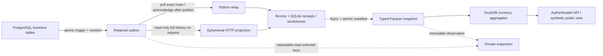

# FluxLake

**Payment changes → durable event history → inspectable, currency-safe analytics.**

[Live synthetic dashboard](https://rohith-fluxlake.vercel.app) · [Live summary API](https://rohith-fluxlake.vercel.app/demo/summary) · [Source](https://github.com/9059Rohith/fluxlake) · [Hosted release evidence](evidence/public-release-verification.json)

A payment update should reach analytics once in its final state—even when a relay crashes, delivery repeats, or an older insert arrives after a delete. FluxLake makes those failure cases visible and reproducible. PostgreSQL captures business changes atomically; a Python relay builds an immutable raw archive, typed Parquet snapshots and DuckDB aggregates. A private diagnostic compares selected projected keys with retained source revisions.

The public demo uses real **synthetic** PostgreSQL writes, including an update and a delete. Its Vercel HTTP instances reconstruct disposable projections from Neon history on requests. It demonstrates request-synchronized recovery; the local Compose profile runs a continuous polling relay. [Deployment details and actual scope](docs/public-deployment.md).

## Five engineering capabilities worth inspecting

| Capability | Concrete implementation | Evidence to inspect |
|---|---|---|
| **Capture that survives inconvenient commit order** | An AFTER trigger writes an outbox envelope and durable per-key revision in the business transaction. The relay acknowledges exact locked rows; identity sequence values never become commit-order checkpoints. | [Source schema](sql/source.sql), [relay](src/fluxlake/worker.py), real PostgreSQL late-lower-ID and rollback tests in [test_postgres.py](tests/test_postgres.py) |
| **Replay-safe state with recoverable publication** | SHA-256 bronze objects preserve canonical inputs. SQLite commits receipts, tombstones and current state together; fsynced Parquet publication follows that commit. Restart reconstructs an interrupted publication. | [Sink commit protocol](src/fluxlake/lake.py), [crash matrix](docs/architecture.md#crash-matrix), [fault and replay tests](tests/test_lake.py) |
| **Explicit data contracts instead of silent drift** | Integer minor units and currency-separated gold SQL; additive typed scalar columns; conflicting schema changes quarantine with raw evidence. Stale events cannot resurrect tombstones. | [Validation and schema registry](src/fluxlake/lake.py), [gold SQL](sql/gold.sql), literal expected-currency tests in [test_lake.py](tests/test_lake.py) |
| **Explainable projection drift** | Authenticated `GET /inspection?key=A&key=B` compares up to 100 selected keys across latest retained outbox events, SQLite state and one immutable Parquet file. Returns revisions, difference categories and both observation identifiers; never repairs or refreshes first. | [Inspection implementation](src/fluxlake/inspection.py), [concurrent snapshot and corruption tests](tests/test_inspection.py), [inspection contract](docs/architecture.md#selected-key-inspection) |
| **A deployable operating model with honest boundaries** | Separate durable polling and ephemeral request-replay profiles, SELECT-only replay capability, fail-closed admin routes, synthetic-only public aggregates, pinned dependencies and a digest-pinned nonroot Python 3.15 image. | [Hosting](docs/hosting.md), [API boundary](src/fluxlake/api.py), [Dockerfile](Dockerfile), [current verification](evidence/inspection-verification.md) |

## Architecture



The profiles are deployment alternatives. Acknowledged polling workers share one durable lake volume; request-mode instances each own a disposable lake and never acknowledge source records. The optional [AWS profile](infra/aws/README.md) supplies DMS WAL capture → Kinesis → Glue/Iceberg → Athena code; its managed execution has not been provisioned or measured.

## Run a real source-to-analytics demo

Requirements: Python 3.12–3.15, Docker Engine and Compose. The commands use PowerShell and assume a fresh checkout/database volume. Keep the same database password when reusing a volume. Linux users can use the corresponding environment and virtualenv commands.

```powershell
python -m venv .venv
.venv\Scripts\python -m pip install --no-deps -r requirements-dev.lock
.venv\Scripts\python -m pip install --no-deps -e .
$env:POSTGRES_PASSWORD = [guid]::NewGuid().ToString('N')
$env:FLUXLAKE_API_TOKEN = [guid]::NewGuid().ToString('N')
$env:FLUXLAKE_PUBLIC_DEMO = 'true'
$env:FLUXLAKE_ALLOWED_HOSTS = 'localhost,127.0.0.1'
# Save values privately in ignored .env to reuse this database later.
docker compose up -d --build
$env:DATABASE_URL = "postgresql://fluxlake:$($env:POSTGRES_PASSWORD)@127.0.0.1:55433/fluxlake"
.venv\Scripts\python scripts/seed.py
Start-Process 'http://localhost:18082'
Invoke-RestMethod http://localhost:18082/demo/summary
```

The seeder commits 20 inserts, one update and one delete with a fresh key prefix each run. Allow the relay to poll, then inspect actual projected keys:

```powershell
$auth = @{Authorization = "Bearer $($env:FLUXLAKE_API_TOKEN)"}
$rows = Invoke-RestMethod http://localhost:18082/transactions -Headers $auth
$key = $rows[0].key
Invoke-RestMethod "http://localhost:18082/inspection?key=$key" -Headers $auth
Invoke-RestMethod http://localhost:18082/pipeline -Headers $auth
```

An inspection returns `match`, `mismatch` or `absent` for every distinct requested key, source/local revisions, difference categories, PostgreSQL snapshot ID/time and Parquet filename/time. It compares **selected keys at two observations**, not the whole source database at one distributed instant. A source commit newer than the projection is legitimate observed drift. `absent` means no retained event and no local row/state for that key; it cannot prove that a pruned event never existed.

To watch drift deliberately: `docker compose stop worker`, change the selected source transaction through PostgreSQL, and repeat inspection. It should report revision/payload differences while leaving the projection unchanged. `docker compose start worker` lets the normal relay catch up. The endpoint does not repair, replay, acknowledge, or bypass quarantine. [Walkthrough and response categories](docs/runbook.md#investigate-projection-drift).

## Invariants and failure walkthrough

| Trigger | Required outcome |
|---|---|
| Business SQL transaction rolls back | Its outbox event rolls back too. |
| A lower identity commits after a higher identity was delivered | Exact-row acknowledgements leave it eligible for the next poll. |
| Same event ID/body reappears | Duplicate receipt; one resulting state. A changed body under that identity quarantines. |
| Older revision arrives after deletion | Durable tombstone prevents resurrection. |
| Crash after SQLite commit, before Parquet publication | Source stays unacknowledged; restart republishes committed state and replay is idempotent. |
| Attribute changes type or input violates the contract | Preserve raw evidence and quarantine; do not mutate silver. |
| Source unavailable or bounded request replay exceeds capacity | Request-backed data fails closed with 503. No fabricated totals replace it. |
| Inspection runs while a source writer commits | One repeatable-read source observation is compared with one locked local observation; later commits wait for the next inspection. |

Example: a settled USD transaction changes from 100 to 200 minor units. The relay durably commits version 2 but crashes before acknowledgement. On restart, the event arrives again; the receipt identifies the same body, silver contains version 2 once, and gold counts 200 once. If version 1 later arrives, it is recorded as stale. [Full commit/crash protocol](docs/architecture.md).

## Reproduce verification

Use a **dedicated disposable test database** because integration tests create source tables, roles, revisions and temporary bootstrap databases. The local test login needs database-creation permission for that bootstrap test; the hosted application does not.

```powershell
docker compose exec postgres createdb -U fluxlake fluxlake_test
$env:TEST_DATABASE_URL = "postgresql://fluxlake:$($env:POSTGRES_PASSWORD)@127.0.0.1:55433/fluxlake_test"
.venv\Scripts\python -m pytest -q
.venv\Scripts\ruff check .
.venv\Scripts\ruff format --check .
.venv\Scripts\python -m pip check
.venv\Scripts\pip-audit --disable-pip --no-deps -r requirements.lock
.venv\Scripts\python scripts/benchmark.py --events 200 --batch-size 10 --output evidence/benchmark-local.json
```

Without `TEST_DATABASE_URL`, PostgreSQL tests explicitly skip. Current inspection work passed **68 tests with no skips on both Python 3.12 and pinned Python 3.15**, each against real PostgreSQL; see [verification evidence](evidence/inspection-verification.md); initial [local](evidence/verification.md), [public runtime hardening](evidence/public-host-hardening.md) and [hosted release](evidence/public-release-verification.json) evidence remain separately dated. The [workflow](.github/workflows/verify.yml) defines PostgreSQL tests, lint, audit, Docker build and Terraform validation. **Hosted Actions cannot currently start because of an account-level runner restriction; no hosted CI pass is claimed.**

## Measured performance, with the sample visible

These are durable **sink batch return timings**, including bronze file fsync, SQLite commit and a full Parquet snapshot rewrite. They exclude PostgreSQL polling, network delay, inspection and AWS. Both runs used Windows 11 / Python 3.12.0 on the local development machine; ten warmup events were excluded. Raw samples and exact library versions are retained.

| Run / workload | Measured batches | p50 / p95 / p99 batch latency | Events/s |
|---|---:|---:|---:|
| [Current pinned libraries](evidence/benchmark-inspection.json), 200 events / batch 10 | 20 | 193.9 / 273.1 / 320.9 ms | 49.61 |
| [Historical initial build](evidence/benchmark-batched.json), 1000 events / batch 10 | 100 | 192.0 / 365.9 / 465.6 ms | 45.83 |

The current run uses PyArrow 26.0.0, DuckDB 2.0.0 and Psycopg 3.3.6. The historical run uses older versions listed in its JSON and a different workload size; this table is not a controlled before/after comparison. Twenty batches make the current p99 the largest observation. These small runs expose snapshot-rewrite cost, not production capacity or an end-to-end freshness SLO.

## Deployment scope and decisions

| Surface | What actually exists | Boundary |
|---|---|---|
| Public Vercel + Neon | HTTPS synthetic dashboard and actual retained-history request projection; [recorded hosted checks](docs/public-deployment.md) | Requests trigger replay, cached five seconds. No continuously running worker. Complete source history required; max 5000 events / 16 MiB replay. |
| Local Compose | PostgreSQL, acknowledged worker, API and durable volumes; real integration/crash tests | Serialized local writers and O(live rows) snapshot rewrites. No multi-host consensus or cross-key source-transaction visibility guarantee. |
| Private inspection | Source/latest-outbox, SQLite and silver comparison, tested locally and in the pinned runtime | 1–100 submitted keys, at most 5000 local rows / 16 MiB Parquet, 64 KiB per source event / 1 MiB selected canonical data. Latest outbox evidence must remain trusted and retained. |
| Optional AWS | Terraform and Glue PySpark source; provider-schema validation recorded | DMS/Glue/Iceberg/Athena execution and managed throughput remain unverified. |

The public surface excludes IDs, arbitrary attributes and unmarked rows. Operational reads, metrics, OpenAPI and writes require a private strong bearer token; input bounds and exact allowed hosts are enforced. `/events` is a fixture/replay route, disabled in request mode. Production ingress must supply TLS and rate limits. Hosted PostgreSQL uses verified TLS and an isolated identity; replay/inspection need only schema USAGE and outbox SELECT. [Security decisions](SECURITY.md) and [hosting configuration](docs/hosting.md).

SQLite supplies transactional identity/order state that Parquet cannot provide. This makes recovery small enough to inspect, while full rewrites deliberately trade scale for clarity. Money stays in integer minor units grouped by currency; FX conversion and currency reference scales require an explicit model. The outbox is application-level polling locally; only the optional AWS path uses WAL CDC. No exactly-once transport claim is made.

## Reviewer and interview path

1. Read the [source trigger](sql/source.sql) and [relay transaction](src/fluxlake/worker.py); explain why `MAX(id)` loses a late commit.
2. Follow [Lake.apply](src/fluxlake/lake.py) through bronze → SQLite commit → Parquet manifest → source acknowledgement; use the [crash matrix](docs/architecture.md#crash-matrix).
3. Run [inspection tests](tests/test_inspection.py), including an actual concurrent source commit and Parquet tampering; explain why `match` has selected-key observation scope.
4. Compare the [poll/request operating models](docs/hosting.md), [failure runbook](docs/runbook.md) and [AWS alternative](infra/aws/README.md).
5. Use the [interview guide](docs/interview.md) to discuss scaling, retention, quarantine, security and measured tradeoffs with evidence.

[Requirement traceability](docs/requirements.md) · [Architecture decisions](docs/adr.md) · [Contributing](CONTRIBUTING.md) · [MIT license](LICENSE)

The current operational feature also has [actual public HTTPS verification](evidence/review-public-feature.json) and a [fresh all-severity runtime image scan](evidence/review-image-scan.json). These complement the dated local experiments; they do not establish a production SLA.
