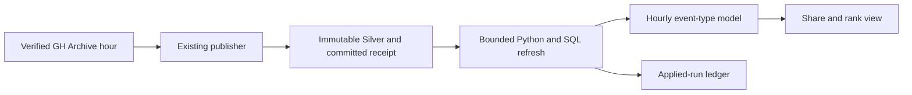

# Incremental hourly public event model

FluxLake’s hosted Gold page groups retained Silver rows when queried. The optional hourly model builds the same kind of SQL result ahead of the read path. It uses the existing archive publisher, with the event and acquisition identities that are already stored in PostgreSQL. [Existing archive replay and recovery evidence](archive-replay-benchmark.md)



The model groups by UTC hour and event type. Each group stores its event count and earliest and latest observed event time. A SQL window view derives its share of the hour and dense rank. The Python benchmark checks those view rows against a full SQL recomputation and independently counts the immutable source objects.

`refresh_hourly` selects at most 32 committed nonempty acquisitions by default, with a caller limit of 128. It uses the Silver run index and checks each receipt against its actual row count. The applied-run ledger and aggregate changes commit in one transaction. A transaction-scoped advisory lock serializes refresh callers. Subsequent calls skip applied run IDs, including retries after a committed refresh. An older timestamp is assigned to its UTC bucket regardless of the newest modeled timestamp. The model assumes Silver identities and committed receipts are immutable. Source corrections require a rebuild or a correction-aware model.

## Reproduce the measured workload

The harness verifies the pinned archive checksum, selects the same first 20,000 admitted unique public events as the archive recovery benchmark and creates a disposable native PostgreSQL cluster. The main event stream uses the existing FluxLake publisher in its archival mode. [GH Archive object](https://data.gharchive.org/2025-01-01-15.json.gz)

```powershell
.venv/Scripts/python.exe scripts/benchmark_hourly_model.py .downloads/2025-01-01-15.json.gz --postgres-bin 'C:/Program Files/PostgreSQL/18/bin'
```

For an explicit downstream setup, apply `sql/workspace.sql` and `sql/hourly_public_model.sql` to a designated analytics database with the public Silver schema. Use a read-committed transaction for `SELECT * FROM flux_analytics.refresh_hourly(32)` and commit after each bounded refresh. The available output is `SELECT * FROM flux_analytics.hourly_mix ORDER BY utc_hour, event_type`. [Model SQL](../sql/hourly_public_model.sql) · [Python runner](../scripts/benchmark_hourly_model.py)

The measured path first backfills 18,000 retained records, then publishes the remaining 2,000 as real 100-event microbatches. It deliberately rolls back the first model refresh, checks that the prior output and ledger persist, and retries through two concurrent callers. The steady phase excludes that fault probe. Each steady step compares the materialized and raw SQL results, and a repeated source batch must produce zero new modeled rows.

Read timings alternate two identical result queries on one warmed PostgreSQL connection. Maintenance timings include local SQL and commit. The publication-to-model timings also include the existing Python publisher. The archive download, upstream source freshness, orchestration intervals, cold-cache reads and hosted request latency are outside those timings.

## Observed results on PostgreSQL 18.2

The model processed 20,000 distinct public events across 200 committed source runs and produced 15 event-type rows in the 15:00 UTC hour. Full SQL equality held after each measured refresh. The final counts and time bounds matched an independent Python calculation from the archive. The model result fingerprint is `18c551aca4ae1953bba3cb37980fc64496eed5bb27b49ef00614a425e14f8e12`. [Measured evidence](../evidence/hourly-public-model.json)

| Operation | Samples or size | Observed time |
|---|---:|---:|
| Initial model backfill | 18,000 events across six refreshes | 175.633 ms total |
| Publisher commit to model commit | 19 batches of 100 events | 5.881 ms median, 14.258 ms p95 |
| Publisher start to model commit | Same 19 batches | 356.216 ms median, 696.289 ms p95 |
| Materialized result read | 40 warm queries | 0.968 ms median, 1.819 ms p95 |
| Equivalent full Silver read | 40 warm queries | 31.601 ms median, 61.570 ms p95 |

A separate `EXPLAIN (ANALYZE, BUFFERS)` observed one shared block hit for the modeled read and 306 for the full query. One of the two concurrent retries applied the interrupted 100-event delta. The other found zero pending runs. The source publisher recognized 100 identical redeliveries as duplicates and the model totals stayed equal. Two steady records arrived behind the prior event-time maximum within the same UTC hour. The evidence covers a single historical hour, sequential publication, and warm local reads.

A separate 200-event contract probe rejected three invalid refresh budgets. It temporarily removed one real Silver row inside a disposable transaction to exercise receipt validation. The mismatch aborted the refresh and the rollback restored all 200 source rows with zero applied runs. A one-run limit then committed exactly two 100-event deltas and a final no-op. All 39 existing workspace and replay tests passed against a separate disposable PostgreSQL cluster. [Contract evidence](../evidence/hourly-public-model-contract.json) · [Regression JUnit](../evidence/hourly-public-model-junit.xml)
